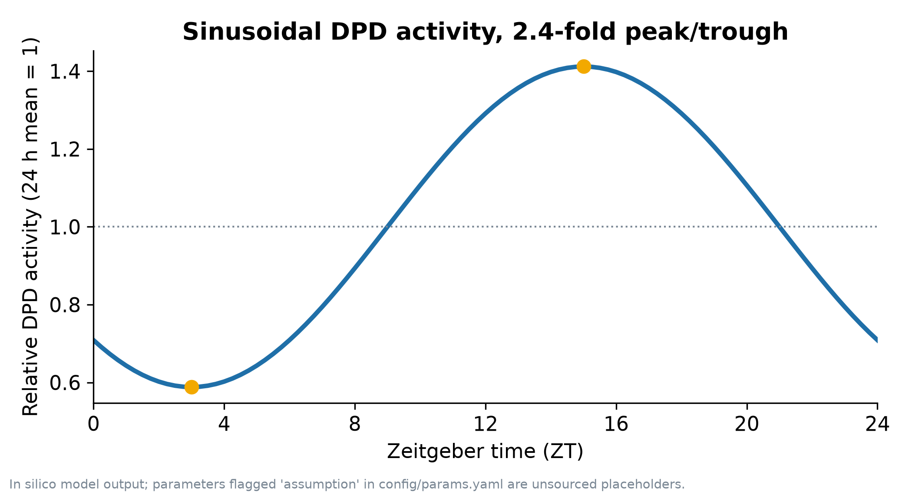
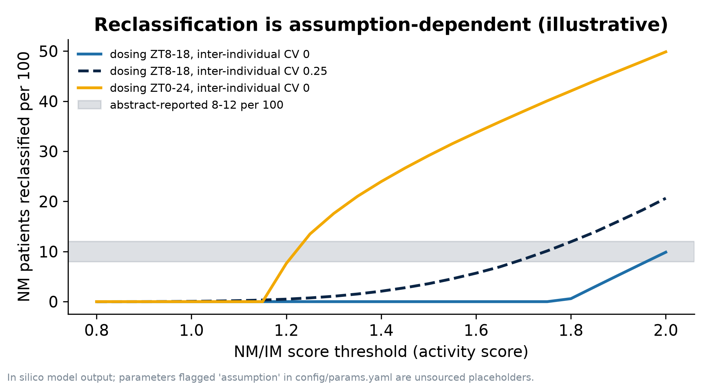
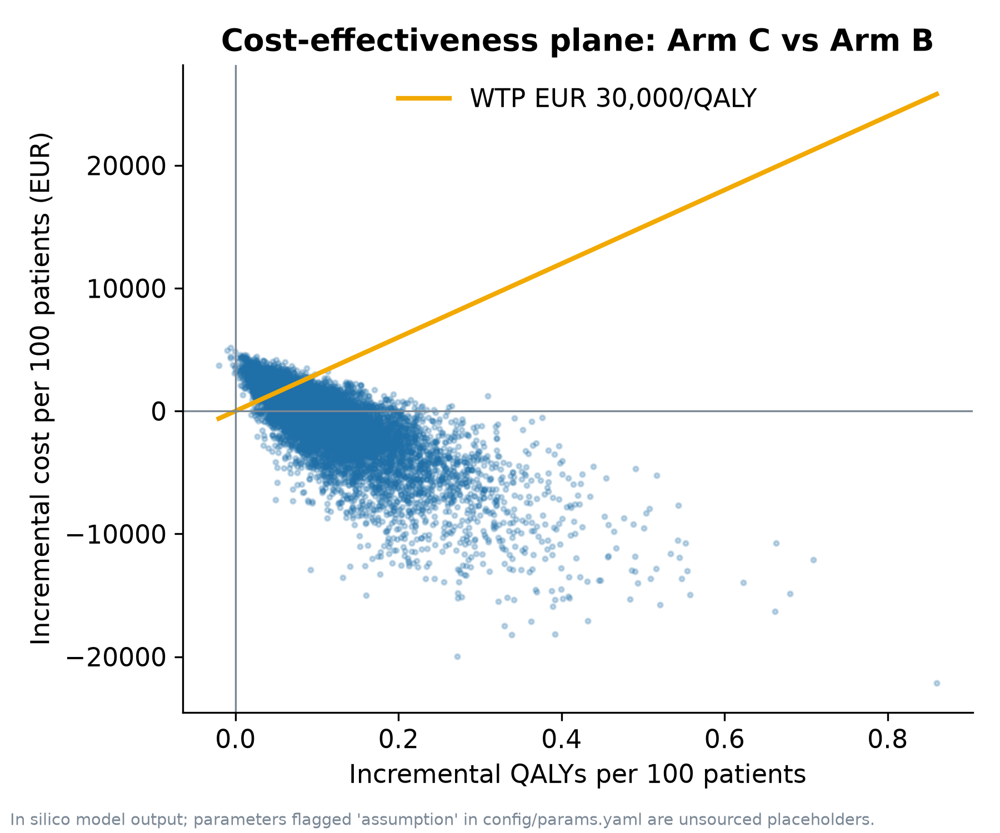
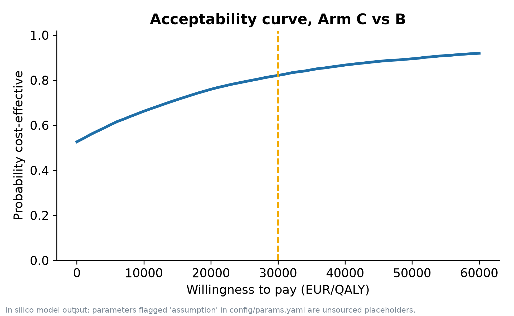
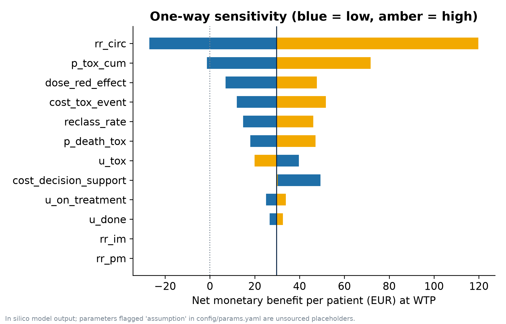
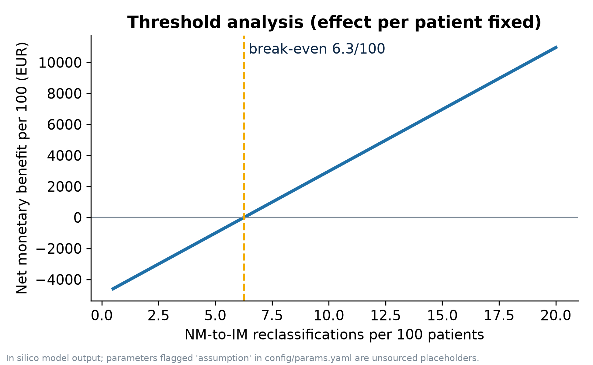
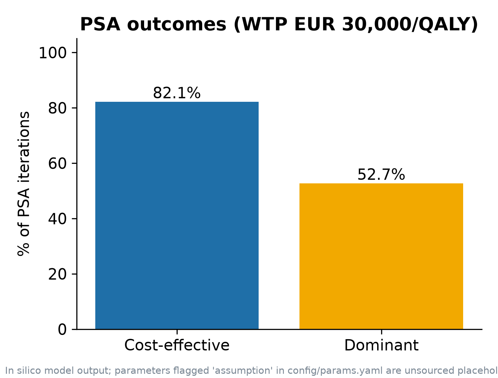

# circadian-dpyd-cea

**An in silico cost-effectiveness model of circadian-adjusted DPYD phenotyping for fluoropyrimidine therapy.**

European payer perspective.

Companion computational repository for the ISPOR Europe 2026 poster:

*Dynamic Circadian-Adjusted DPYD Phenotyping for Fluoropyrimidine Therapy: An In Silico Cost-Effectiveness Analysis for Precision Oncology.*

**Software author and maintainer:** Jashuva-T
**License:** Apache-2.0

## Project overview

This repository implements a probabilistic cost-effectiveness model comparing conventional DPYD-guided phenotyping with a circadian-adjusted phenotyping strategy for fluoropyrimidine therapy.

The computational framework combines DPYD pharmacogenomic risk stratification, circadian variation in DPD activity, treatment-associated toxicity, healthcare costs and health-related utility outcomes.

The analysis includes deterministic modelling, probabilistic sensitivity analysis (PSA), cost-effectiveness evaluation and threshold analyses.

## Model provenance and interpretation

Model inputs are classified according to their provenance:

- **Abstract-reported:** Values reported in the accompanying ISPOR Europe 2026 abstract.
- **Abstract-derived:** Values mathematically derived from abstract-reported quantities.
- **Model assumptions:** Author-selected inputs used to parameterize the model. Their uncertainty is represented using the probability distributions specified in the configuration.

The circadian-associated relative-risk parameter is calibrated against the abstract-reported midpoint for events prevented. This is a calibration procedure, not independent empirical validation.

The computational outputs in this repository are distinct from the findings reported in the conference abstract. Differences are retained transparently rather than eliminated through undocumented parameter adjustment.

The PP4 value of 0.83 is stored as an abstract-reported input and is not independently recomputed by this repository. The data requirements and methodological considerations for recomputing colocalization are described in [data/README.md](data/README.md).

## Results of the configured model run

Seed: `20261104`
PSA iterations: `10,000`

| Output | Repository model | Abstract |
|---|---:|---:|
| Events prevented per 100 (C vs B) | 2.05 (calibration target) | 1.7–2.4 |
| Hospitalization cost averted per 100 | €4,715 (derived) | €3,900–5,600 |
| Net cost / QALY gain per 100 | €314 / 0.110 | Not reported |
| ICER, Arm C vs B | €2,861/QALY | ~€15,278/QALY |
| PSA cost-effective at €30,000/QALY | 82.13% | 89.2% |
| PSA dominant | 52.66% | 41.3% |
| Break-even reclassification | 6.27 per 100 | >4 per 100 |

These are outputs from the currently configured model, not independently validated clinical or economic estimates.

The model ICER does not reproduce the abstract's reported ICER. The incremental QALY estimate depends on the utility decrement assigned to toxicity, which is not specified in the abstract. The model's outputs therefore should not be presented as a numerical reproduction of the abstract.

The calibrated events-prevented estimate is a calibration target and must not be interpreted as independent confirmation of the assumed circadian effect.

## Figures















The reclassification sensitivity analysis illustrates that the reclassification rate cannot be inferred from circadian amplitude alone. It also depends on dosing-time window, activity-score threshold and inter-individual variation. These modelling choices require explicit justification.

## Model structure


The model uses monthly cycles over a 60-month horizon and six treatment cycles.

Model states include full-dose treatment, dose reduction, Grade 3–4 toxicity, completed treatment (alive), and death.

Arm B applies dose reduction to intermediate and poor metabolizers. Arm C additionally applies dose reduction to circadian-reclassified normal metabolizers and includes a decision-support cost.

Genotyping cost is identical in Arms B and C and therefore cancels in their incremental comparison.

## Reproducibility

### Requirements

- Python 3.10 or later
- Dependencies listed in `requirements.txt`

### Installation and execution

```bash
python -m venv .venv
source .venv/bin/activate

make install
make test
make run
```

The pipeline writes figures, tables and a summary file under `results/`.

The random seed and PSA iteration count are specified in `config/params.yaml`. Continuous integration runs the test suite and independently executes the pipeline.

## Repository layout

```text
config/params.yaml       Model parameters, provenance and PSA distributions
src/circadian_dpyd/      Model, genetics, circadian, colocalization and analysis modules
tests/                   Automated tests
results/                 Generated figures, tables and model summary
data/README.md           Data requirements and colocalization instructions
```

## Limitations and interpretation

This is an in silico economic model. Its results depend on the model structure, parameter assumptions, calibration procedure and uncertainty distributions.

The current implementation does not independently validate the underlying circadian phenotype, establish prospective clinical utility or demonstrate a causal clinical benefit from circadian-adjusted dosing.

Additional limitations include the absence of an efficacy or survival effect associated with dose reduction, simplified handling of poor metabolizers, and a single European payer setting.

The model's assumptions and their uncertainty should be reviewed before its outputs are used to support clinical, policy or commissioning decisions.

## Citation and license

Please see [CITATION.cff](CITATION.cff) for software citation information.

Distributed under the [Apache License 2.0](LICENSE).
